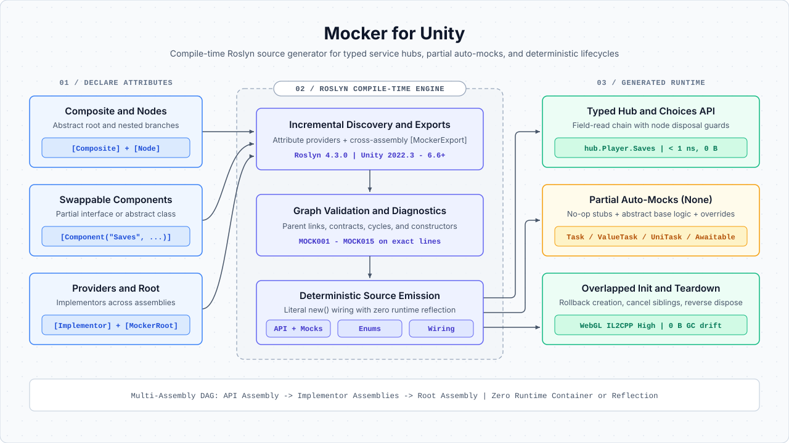

### About Mocker

Compile-time Roslyn source generator for Unity that builds typed, zero-allocation service hubs with constructor DI, partial auto-mocks, overlapped async init, and reverse disposal.



Declare a `[Composite]` root, `[Node]` branches, `[Component]` partial interfaces or abstract classes, and `[Implementor]` providers across assemblies. Mocker resolves constructor graphs during compilation and writes literal `new` calls with zero runtime reflection or container overhead.

Unselected slots (`None`) receive generated partial mocks that keep abstract base logic intact and return completed awaitables. Every wiring or contract mistake reports `MOCK001` through `MOCK015` against the exact attribute line in Unity and your IDE.

### Features

1. Nested typed API with `< 1 ns`, `0 B` field-read access.
2. Interface and abstract class `[Component]` mocking.
3. Compile-time constructor DI and selection enums.
4. Partial auto-mocks supporting hand-written overrides.
5. Overlapped async initialization with partial-failure cancellation.
6. Rollback-safe construction and atomic reverse disposal.
7. Cross-assembly discovery via `[MockerExport]` metadata.
8. Fifteen compile-time diagnostics (`MOCK001`-`MOCK015`).

Detailed about features - see [FEATURES.md](Documentation/FEATURES.md).

### Performance

Hot-path service walks (`hub.Player.Inventory.Items`) execute as direct field reads behind a boolean disposal guard, verified at `0 B` heap allocation across `10,000` iterations after warmup. Construction allocates only the hub, its selected implementors, and tracked `IDisposable` references, releasing `Dependencies`, cycle-tracking scratch state, and completed initialization tasks immediately after their phase ends. Disposal releases all subtree references so `2,000` create/initialize/dispose cycles leave `0 B` of retained heap drift.

Detailed about performance - see [PERFORMANCE.md](Documentation/PERFORMANCE.md).

### Requirements

1. Unity `2022.3` LTS through Unity `6+` (`6000.x`, verified on `2022.3.62f3` and `6000.6.7f1`) with Mono or IL2CPP (`High` managed stripping) across WebGL, Android, iOS, Desktop, and Dedicated Server.
2. `UnityEngine.Awaitable` requires Unity `2023.1` or newer; `Task`, `ValueTask`, and `UniTask` work on Unity `2022.3` LTS and newer.
3. Git on `PATH` when installing from the Git URL, or no external tools when installing from a release `.tgz` tarball.

### Limitations

1. A composite, its nodes, and its components must be declared in the same assembly.
2. Constructor cycles cannot be instantiated and throw `InvalidOperationException` naming the exact cycle path at construction.
3. Custom reference-type awaitables and `ref`-returning members report `MOCK011` unless satisfied in a hand-written partial mock.
4. Abstract class components require an accessible parameterless constructor (or a hand-written public parameterless constructor on the partial mock) for `None` slots (`MOCK015`).
5. Implementor assemblies excluded by platform constraints drop out of generated enums, so selection code referencing those entries requires matching `#if` guards.

### How to install

1. Add the package via Git URL in Unity Package Manager (`Window -> Package Manager` on Unity `2022.3`, or `Window -> Package Management -> Package Manager` on Unity `6`), click `+`, choose `Add package from git URL...` / `Install package from git URL...`, and enter:

```text
https://github.com/reromanlee/Mocker.git?path=UnityPackage#2.0.0
```

2. Or download `com.reromanlee.mocker-2.0.0.tgz` from GitHub Releases, place it beside `Packages/manifest.json`, and reference it directly:

```json
{
  "dependencies": {
    "com.reromanlee.mocker": "file:com.reromanlee.mocker-2.0.0.tgz"
  }
}
```

The source generator ships as `UnityPackage/Runtime/Plugins/reromanlee.Mocker.Generator.dll` with the `RoslynAnalyzer` label and all runtime platforms excluded, so Unity loads it automatically with zero extra setup.

### How to use

Declare the hub shape using `[Composite]`, `[Node]`, and `[Component]` (supporting both `partial interface` contracts and `abstract partial class` components with shared core logic), then attach concrete `[Implementor]` classes in the same or separate assemblies.

```csharp
using reromanlee.Mocker;
using System.Threading;
using System.Threading.Tasks;

[Composite]
public abstract partial class Services { }

[Node("Player", typeof(Services))]
public partial class Player { }

[Component("Saves", typeof(Player))]
public partial interface ISaves
{
    string Read(string key);
}

[Component("Audio", typeof(Services))]
public abstract partial class AudioService
{
    public string DefaultBus => "Master";
    protected abstract float BaseGain();
    public float EffectiveGain() => BaseGain() + 0.5f;
}

[Implementor(typeof(ISaves))]
public sealed class FileSaves : ISaves, IAsyncInitializable<Task>
{
    public FileSaves(SaveSettings settings) { }
    public Task InitializeAsync(CancellationToken cancellationToken) => Task.CompletedTask;
    public string Read(string key) => key;
}
```

Mark the composition root assembly with `[assembly: MockerRoot]`, select implementors through the generated choices tree (leaving unset slots at `None` for generated mocks), initialize asynchronously, and dispose deterministically.

```csharp
[assembly: MockerRoot(typeof(Services))]

var choices = new ServicesChoices { Player = { Saves = SavesImplementor.FileSaves } };
var dependencies = new Dependencies().Register(new SaveSettings());

using (var services = new ServicesComposite(choices, dependencies))
{
    await services.InitializeAsync();
    string profile = services.Player.Saves.Read("profile");
    float gain = services.Audio.EffectiveGain();
}
```

Detailed about usage - see [USAGE.md](Documentation/USAGE.md).

Detailed about continuous integration - see [CI.md](Documentation/CI.md).

### License

Made by Roman Likhadievski (reromanlee.com).

Licensed under MIT - see [LICENSE.md](LICENSE.md).
